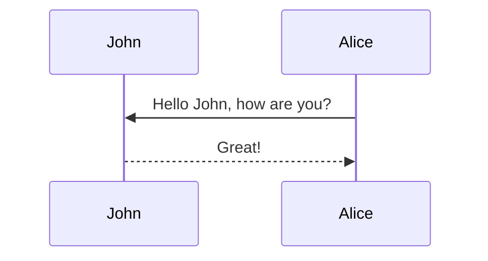

This theme supports generating diagrams from a text description using [Mermaid](https://mermaid.js.org/).
Diagrams are rendered in the browser by the `al_charts` plugin; no separate Mermaid CLI installation is needed.

## Mermaid

The diagram below is generated by the following code:


````markdown

````



